# shim 与 override：机制设计

> 面向**尚未实现该机制**的 torchtitan 树外扩展。上游按 commit SHA 固定，扩展住在树外。
> 渲染版（含全部图）：见 `docs/README.md` 里的 artifact 链接。

torchtitan 是为 CUDA 写的。要在别的加速器上原样跑它，必然有一批地方需要改。
这份文档不讲改哪些地方，只回答一个问题：**这些改动应该长什么样，才不会变成一个 fork。**

四个出口，代价递增。全文按这四类展开：

| 出口 | 什么时候走 |
|---|---|
| **配置** | 上游已有开关。一行配置不是负债。 |
| **override** | 要改的是配置树上已有的 `Configurable` 节点。上游自己的扩展点。 |
| **shim** | 要改的是 import 期就定死的代码。受治理的猴补丁，挂 issue，有到期日。 |
| **禁止** | 设备后端的缺陷，以及护栏。只能修上游。 |

每往右一步都要有理由，而且理由写进代码里，不是写进 commit message。

---

## 1. 设计思路

一处改动的形态，由三个问题依次决定。

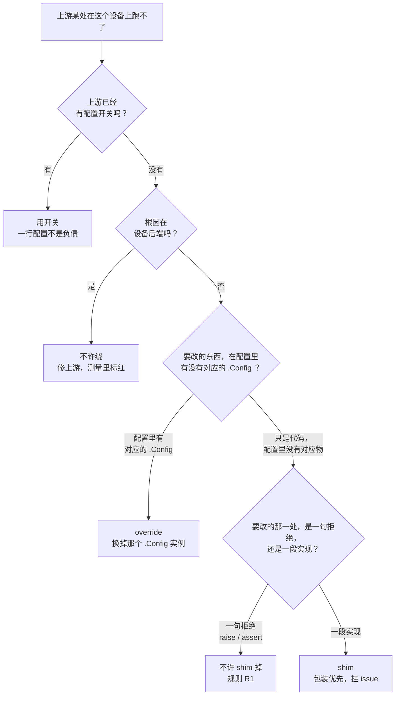

### 三个词的意思

| 词 | 指什么 | 怎么认出来 |
|---|---|---|
| **节点** | 配置树上的一个 `.Config` 实例。上游的配置是一棵 dataclass 树，每个可替换组件（注意力、loss、优化器、dataloader）在树上都有自己的 `.Config`。一个节点有地址，形如 `layers.0.attention.inner_attention`。 | 能用 FQN 指到它，就是节点。override 做的事就是把某个地址上的实例换成另一个类的实例。 |
| **一段实现**（机制） | 真正干活的代码：一个函数、一个 `torch.compile` 的产物、一个 import 期算好的常量。 | 它有输入有输出。换掉它，行为改变，语义仍然成立。 |
| **一句拒绝**（护栏） | 一句 `raise` / `assert`，用来挡住一个上游没有实现的组合。 | 问一句：**它挡住的那件事，实现在哪里？** 找不到实现，就是护栏——它不是限制，它是在替你避免一个错误的结果。 |

这三者的区别决定了改动的形态，所以它是这张图上唯一需要判断的地方；其余分支都是查一下有没有开关、归因在谁。

---

## 2. 原理

### 2.1 为什么是两套机制

上游的可扩展点分两种，**生命周期不同**，所以不能用同一套机制。

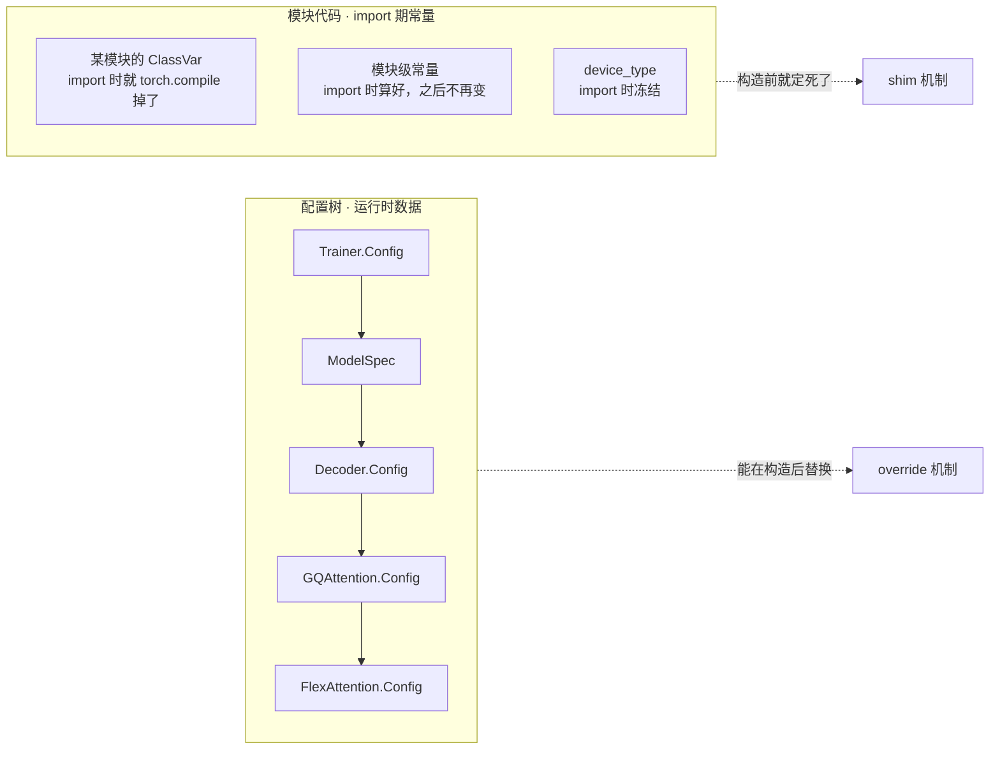

| | override | shim |
|---|---|---|
| 作用对象 | 配置树上的 `Configurable.Config` 节点 | 模块属性 / 类属性 |
| 时机 | 配置构造后、`build()` 前 | **第一次 import 上游之前** |
| 用户可控 | ✅ `--override.imports` | ❌ 全局生效，只能整条关掉 |
| 上游是否知情 | ✅ 上游自己的机制 | ❌ 猴补丁，目标随时可能被挪走 |
| 负债性质 | 低——上游支持的扩展点 | 高——每条必须挂 issue，上游修好即删 |

### 2.2 分层

依赖只能向下。

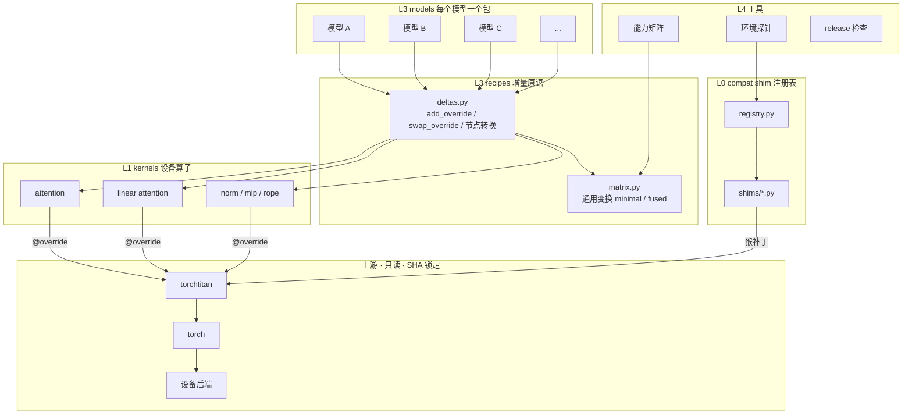

`kernels/` 不认识 `models/`；`deltas.py` 不认识具体模型；模型包逐条写出自己需要什么——
**读那个函数就知道换了什么、没换什么。**

### 2.3 一次训练启动

这张图里唯一不能动的是顺序。

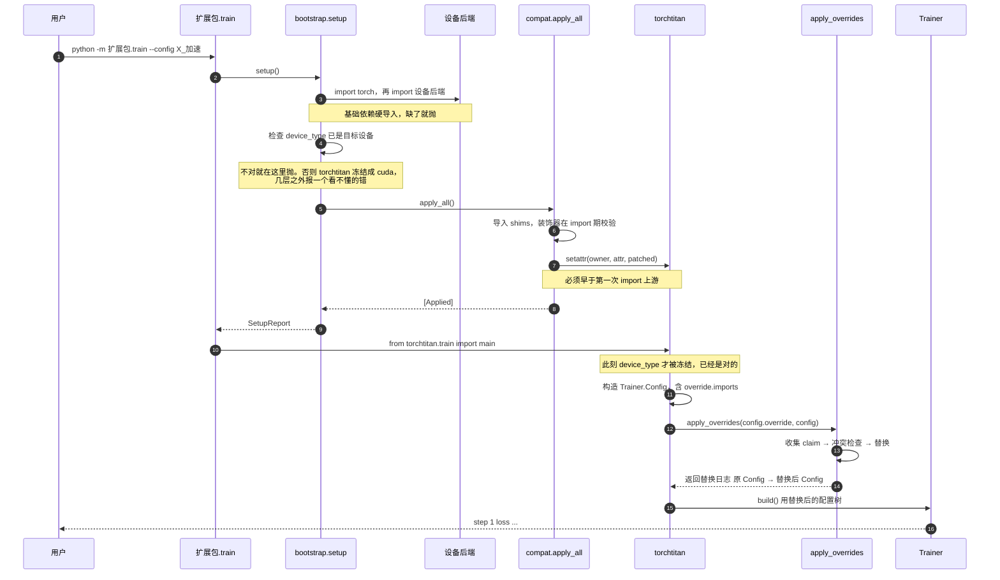

上游在 import 期就用 `torch._utils._get_available_device_type()` 把 `device_type` 冻死。
`setup()` 晚一步，整个训练跑在 `cuda` 分支上。所以 bootstrap 要检测「上游是否已被导入」并告警。

---

## 3. 具体设计

### 3.1 shim 注册表

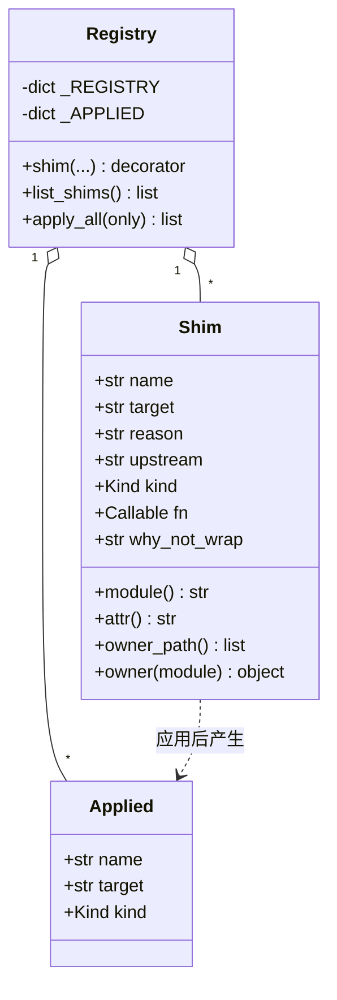

### 3.2 target：要打的那个位置怎么写

`target` 是一个字符串，冒号左边是模块，右边是模块里的属性名；右边可以再用点分下去，
以触达类属性。一条 shim 因此只需要一行就能定位到任意一个可 `setattr` 的位置。

| 写法 | 打到哪里 |
|---|---|
| `"pkg.mod:func"` | 模块级函数或变量 |
| `"pkg.mod:Cls.attr"` | 类属性 / ClassVar——先取到 `Cls`，再对它 `setattr` |

注册表把 `target` 拆成三部分：`module`（冒号左边）、`owner_path`（中间那些点分名，用来一路
`getattr` 找到真正持有属性的对象）、`attr`（最后一段，`setattr` 的那个名字）。
`owner_path` 为空就打在模块上，否则打在类上。

### 3.3 注册期校验

校验跑在 `@shim` 装饰器里，也就是 import 期——所以一条写坏的 shim 挂的是 CI，不是半夜的训练任务。

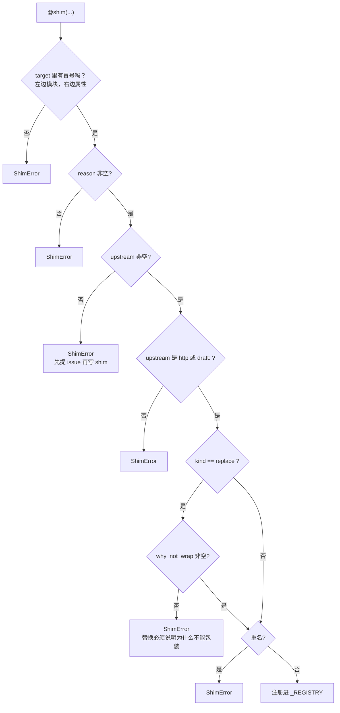

### 3.4 三种 kind

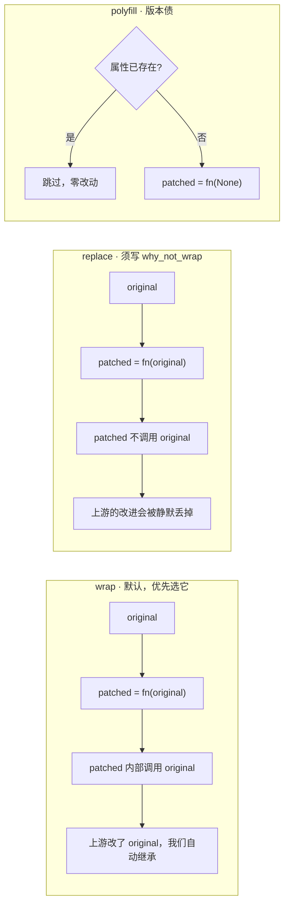

| kind | 什么时候用 | 它干什么 | 解决什么问题 | 代价 |
|---|---|---|---|---|
| `wrap`（默认） | 上游那个函数本身是对的，只是**少做一步**你的设备需要的动作 | 收到 `original`，返回新函数；新函数内部调用 `original`，再在前后加行为 | 「上游没有为这个设备留分支」——你补上分支，主体逻辑还是上游的 | 几乎没有。上游以后改了 `original`，你自动继承 |
| `replace` | 上游那个对象**本身就是问题**，包一层没有意义 | 返回一个完全不同的实现，不调用 `original` | 典型是「上游在 import 期无条件 `torch.compile` 了某个函数」——包装它照样会进编译器，只有换掉才有用 | 高。上游对原实现的改进会被**静默丢掉**，所以注册时强制填 `why_not_wrap` |
| `polyfill` | 当前版本的上游**还没有**一个你依赖的 API | 属性不存在时补上；**已存在则整条跳过** | 版本差——你按 nightly 开发，用户可能在旧版上；作为 plugin 需要有「上游缺 API 就补」的能力 | 版本债。上游长出该属性后自动失效，然后应当删除 |

三者里只有 `polyfill` **会自己消失**：目标属性一旦存在，`apply_all` 记一条 INFO 就跳过。
`wrap` 与 `replace` 的消失要靠特性探测或上游合入后人工删除。

> **选型：先问「能不能包装」，不能再问「为什么不能」。**
> 把 `why_not_wrap` 做成注册期必填，是为了让「换掉上游实现」这个决定必须被写下来一次。
> 一条写不出理由的 `replace`，通常说明它其实应该是 `wrap`，或者根本不该存在。

### 3.5 shim 的生命周期

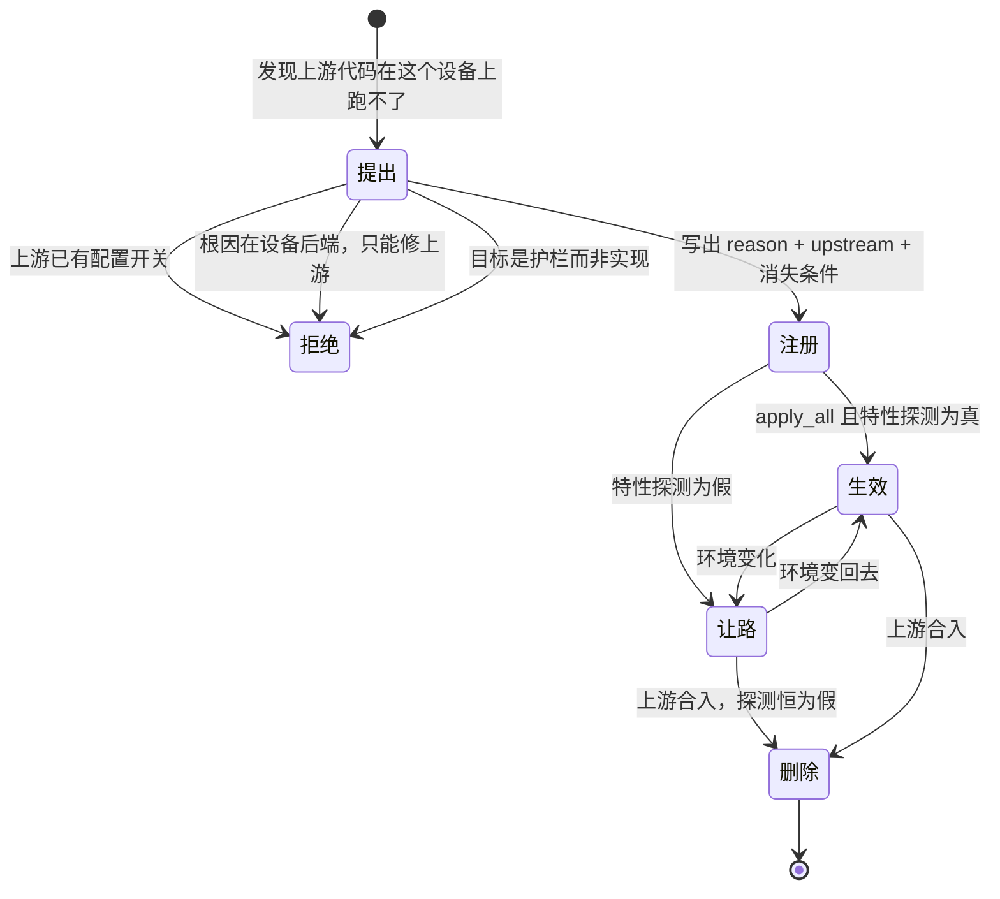

「让路」是运行时行为，不是版本号判断——换到具备该能力的硬件上自动生效。

### 3.6 override：五步

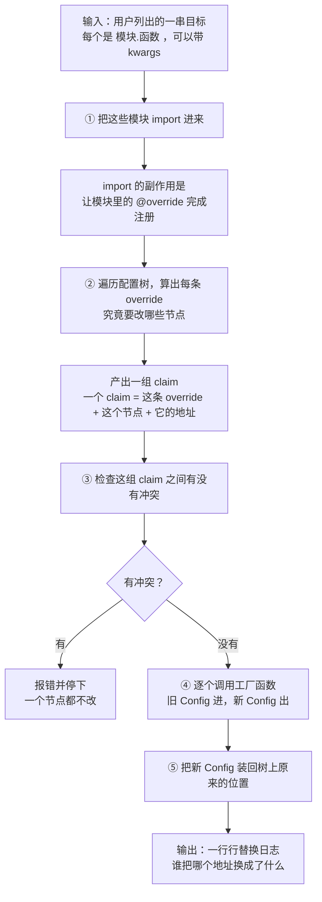

| 步骤 | 在做什么 | 为什么是这个顺序 |
|---|---|---|
| ① 导入 | 把用户列出的模块 import 进来 | 注册是 `@override` 装饰器在 import 期干的事，所以「有哪些 override 可用」只有导入之后才知道 |
| ② 匹配 | 遍历配置树，找出每条 override 要改的节点 | 匹配规则两条：节点类型是不是这条 override 声明的 `target` 类（默认连子类一起算），以及节点地址是否命中它的 `fqns` 通配符 |
| ③ 查冲突 | 看这组 claim 之间有没有互相踩 | **必须在任何一次替换之前** |
| ④ 构造 | 把旧 Config 交给工厂函数，拿回新 Config | 工厂只负责「换成什么」，不负责「换哪儿」——换哪儿在 ② 就定好了 |
| ⑤ 写回 | `setattr` 回树上原来的位置 | 父容器与属性名在 ② 已经记在 claim 里，写回是纯机械动作 |

**claim 是这套流程里唯一需要新记住的概念**：它不是「一条 override」，而是「*这条 override*
要改 *这一个* 节点」。一条 override 用通配符命中 24 层，就产生 24 个 claim。
冲突检查检的是 claim，不是 override——所以两条 override 即使针对同一个 Config 类，
只要它们的 `fqns` 落在互不相交的层上，就不算冲突。这也是「同一个算子在一半层上 A/B 对比」
这种用法能成立的原因。

③ 为什么必须早于 ④：如果边遍历边替换，谁先谁后取决于用户写的目标顺序，冲突就变成一个
**时好时坏**的现象。先收集、再检查、最后统一改，冲突是一个确定性的错误，而且报错时
配置树还是完整的——一个节点都没动过。

### 3.7 两种冲突形态

区别不在于「谁和谁撞」，而在于**相等判定能不能发现它**。

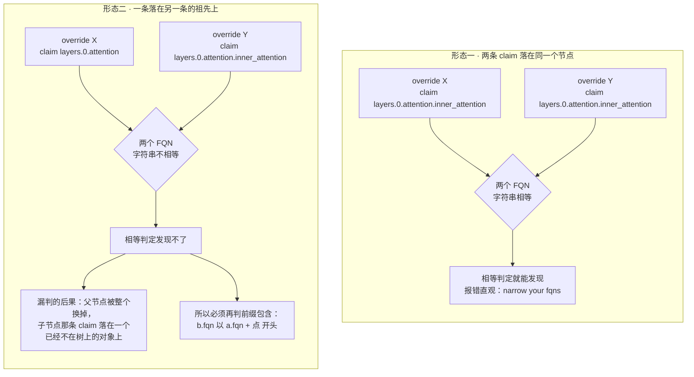

> **冲突判定两条规则：相等，以及前缀包含。**
> 只判「两条 claim 的 FQN 是否相等」，会漏掉形态二——因为 `layers.0.attention` 和
> `layers.0.attention.inner_attention` 本来就是两个不同的字符串。判定必须补上第二条：
> **一方的 FQN 是不是另一方加上一个点之后的前缀**。两条都不成立，才算无冲突。

形态二在实际使用中很容易撞上，因为**上游自己也会提供 override**，而它可能认领一整块
（例如整个注意力块）。那一块同时是 inner attention 与 RoPE 两个节点的祖先，于是你针对
这两个节点的 override **都**要让位，不是只让一个。所以通用变换在施加自己的 override 之前，
得先看配置里已经存在哪些 override。

### 3.8 嵌套配置怎么换：derive

当一个节点需要连同它的子节点一起换，不能写两条 override（会触发形态二），
而是**一条 override 在父节点上，用 `derive` 就地构造子节点**。

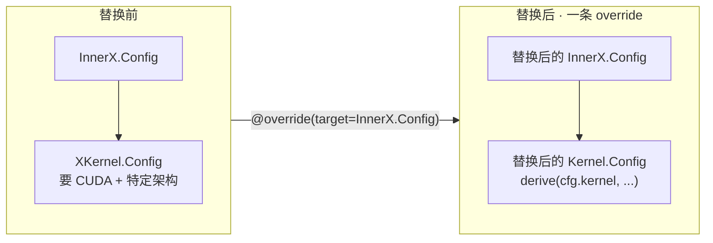

`derive` 的价值是**版本鲁棒**：目标 Config 以后长出新字段时，同名字段自动从 source 复制，
而不是静默退回默认值。工厂函数只写它真正要改的那几项。

---

## 4. 案例

### 4.1 注意力：一条链路，两个入口

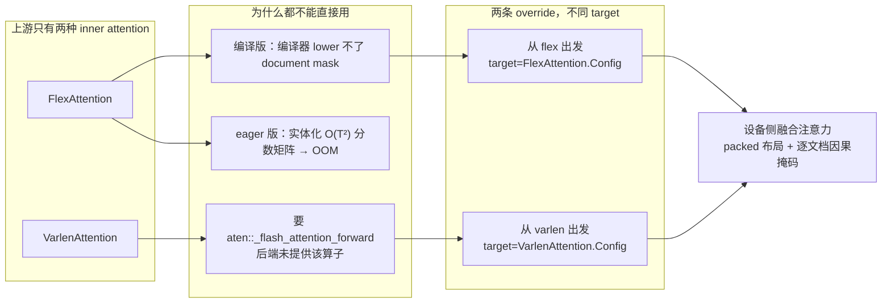

两条 override 的 target 是不同的 Config 类，因此可以同时激活——上游不同 flavor 的默认节点不一样。

### 4.2 序列并行：为什么这条 override 必须*不*生效

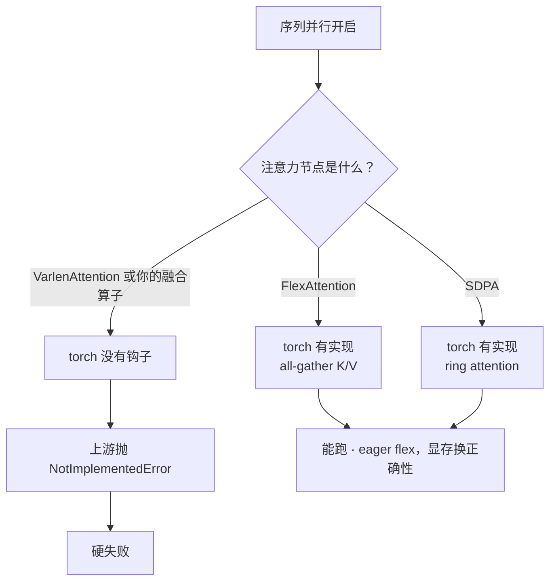

所以这条转换必须带一个前置条件：序列并行打开时直接返回，什么都不做。
**一个增量的适用条件，和这个增量本身一样，是设计的一部分。**

### 4.3 规则 R1：护栏不许 shim 掉

这是四个出口里唯一一条「看起来能做、但绝不能做」的，所以单独列成规则。

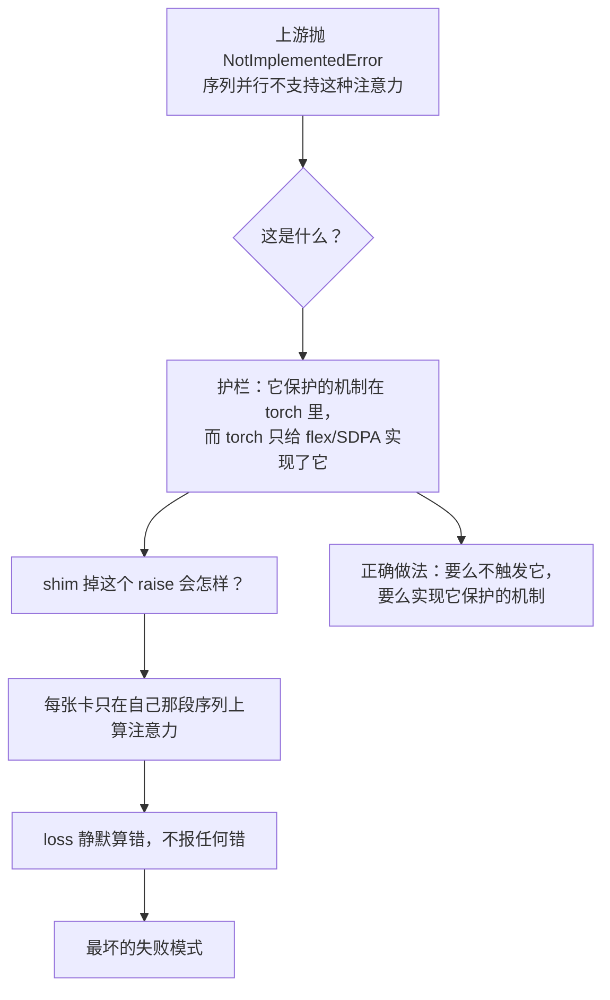

> **R1：一处 `raise` / `assert` 是护栏还是机制，决定它能不能被 shim。**
> 判断方法：**问这个 raise 保护的东西在哪里实现**。找不到实现，就是护栏。
> 护栏背后如果有未实现的机制，绕过它得到的不是「能跑了」，是「错得没有声音」。

---

## 5. 决策记录

### ADR-008（提案）门控探测根因，不探代理信号

- **Context**：每条增量都需要一个「什么时候不再需要我」的判据。最省事的写法是探一个容易拿到的
  相邻信号——某个包装没装、某个后端在不在。这类代理信号会在环境变化时**先于根因翻转**：
  装上一个包，探测变真，增量停止生效，而真正的限制还在，故障出现在离探测很远的地方。
- **Decision**：特性探测必须指向**根因本身**可观测的开关，哪怕那个开关更难拿到、是上游的私有属性。
- **Alternatives**：版本号比较——版本号不描述硬件能力，排除。试跑一次再回退——代价不可控，
  且会掩盖归因。
- **Consequences**：正面，环境或硬件变化时增量自动让路，不需要改代码，也不需要有人记得去改。
  负面，探测点常是上游私有属性，上游改名就会失效——因此所有探测集中在一个函数里，
  让它一处失效、一处修。

### ADR-009（提案）护栏不可 shim

- **Context**：上游为「这个组合我没实现」写的 `raise`，在使用者眼里和「这个组合被禁止了」
  长得一模一样。而 shim 恰好能一行删掉它，删完程序确实跑起来了。
- **Decision**：shim 不得移除 `raise` / `assert`，除非同时提供它挡住的那段实现。
- **Alternatives**：先删掉跑通再说——排除。护栏挡住的通常是「这条路上有一段计算没人做」，
  绕过去的结果不是报错，是一个安静的错误数值。
- **Consequences**：正面，杜绝一类无声的数值错误，这类错误在训练里可能几天才被发现。
  负面，某些能力要等你自己把机制实现出来，周期更长；这是应该付的代价。

---

## 6. 风险与对策

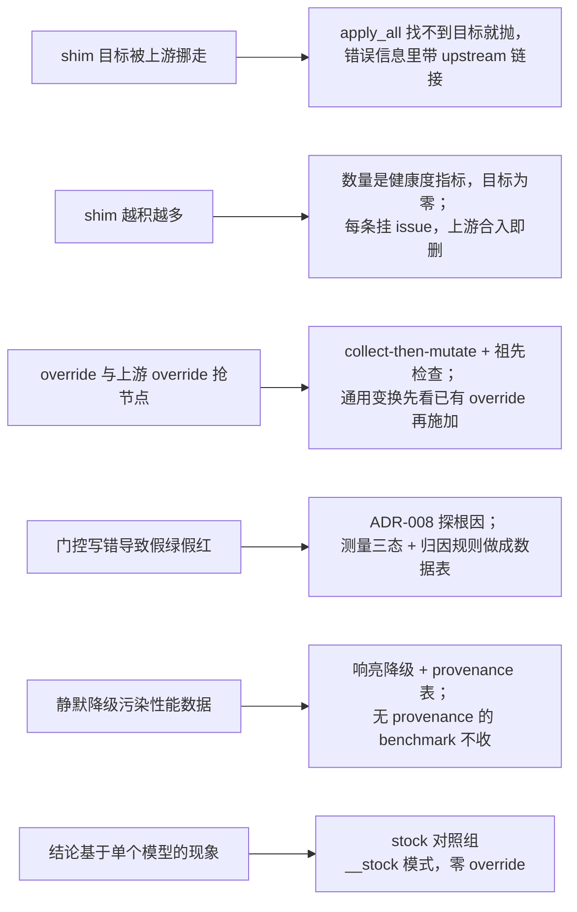

> **R6：没有对照组，就分不清「上游的问题」和「你的问题」。**
> 做法：让每个测量格子都能用一个后缀（例如 `__stock`）跑一遍**零 override** 的对照。
> 同一个用例，一次带你的增量、一次完全不带，两次都记录。没有这条，一个红格到底是
> 上游本来就不支持，还是你的替换弄坏的，只能靠猜——而猜错会把自己的问题写成硬件限制。
